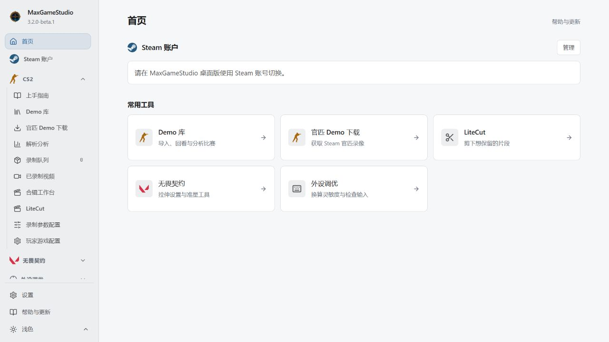

<h1 align="center">MaxGameStudio</h1>

English · <a href="./README.zh-CN.md">简体中文</a>

CS2 match review and recording, Steam account switching, and VALORANT and input tools for Windows. The beta pairs the main app with a separate League of Legends toolbox.

## Downloads

Windows 10/11 · x64

| App | Version | Installer | Download size |
| --- | --- | --- | --- |
| **MaxGameStudio** | 3.2.0-beta.2 | [Download EXE](https://github.com/INEEDBUG/MaxGameStudio/releases/download/v3.2.0-beta.2/MaxGameStudio_3.2.0-beta.2_x64-setup.exe) · [SHA-256](https://github.com/INEEDBUG/MaxGameStudio/releases/download/v3.2.0-beta.2/MaxGameStudio_3.2.0-beta.2_x64-setup.exe.sha256) | 40.3 MiB |
| **HKsLGT (League Toolbox)** | Beta | [Download and SHA-256](https://github.com/INEEDBUG/HKsLGT/releases) | 6.7 MiB |
| **MaxGameStudio stable** | 3.1.4 repair | [Download EXE](https://github.com/INEEDBUG/MaxGameStudio/releases/download/v3.1.4/MaxGameStudio_3.1.4_x64-repair-setup.exe) · [SHA-256](https://github.com/INEEDBUG/MaxGameStudio/releases/download/v3.1.4/SHA256SUMS) | 137.4 MiB |

Historical installed sizes were MaxGameStudio 3.2.0-beta.2 107–108 MiB and MaxGameStudio League 1.0.0-beta.2 335 MiB.

GitHub keeps one beta and up to three stable releases for each app, while Git tags and source history remain available.

Program sizes exclude user data and the main app's shared Windows WebView2 runtime. Stable 3.1.4 repair includes the League workspace. The two beta apps install separately and each checks its own beta update channel.

[Main app release notes](https://github.com/INEEDBUG/MaxGameStudio/releases/tag/v3.2.0-beta.2) · [League releases](https://github.com/INEEDBUG/HKsLGT/releases) · [All releases](https://github.com/INEEDBUG/MaxGameStudio/releases)

*MaxGameStudio 3.2 beta home page in the Simplified Chinese UI preview.*

## Features

| App | What it does |
| --- | --- |
| **MaxGameStudio** |  Switch between Steam accounts already saved on this PC. Use Steam for sign-in and Steam Guard when prompted. |
| **MaxGameStudio** |  Import and analyze CS2 demos, review rounds on a 2D replay, and record highlights in OBS or edit them in LiteCut. |
| **MaxGameStudio** |  Preview VALORANT display settings, edit crosshairs, and use the sensitivity and magnetic-key tools. |
| **MaxGameStudio League** |  Connect to the local League client for champion-select tools, match history, live-game views, and the RESG Hextech ARAM reference window. |

[Player guide](./PLAYER_GUIDE_EN.md) · [Detailed features and historical screenshots](./docs/feature-reference.en.md)

## Installation and data

1. Double-click the installer for the app you want. Both beta installers are in Simplified Chinese. Choose **Only for me** or **All users**; the latter requests administrator permission when you continue and installs the program in Program Files.
2. To upgrade the main app over 3.1.4 repair, use the same Windows account. Existing data locations, settings and databases are preserved. Current-user upgrades reuse the existing program folder. If you choose to migrate data, the original is retained.
3. Install the League toolbox separately. On first launch it can copy the detected embedded workspace's settings and database to its own data folder. The original data remains available.

Current-user installs let you choose program and data folders. All-users installs share program files; each account keeps its own data location. Windows permission dialogs use the system display language.

Exit your game and let Steam finish syncing before switching accounts. Steam may ask you to sign in again.

## Development and license

MaxGameStudio is a noncommercial derivative. **INEEDBUG** maintains the project. [Authors](./AUTHORS.md) · [Development setup](./docs/dev-setup.md) · [Contributing](./CONTRIBUTING_EN.md)

The project uses PolyForm Noncommercial 1.0.0. Retain the applicable copyright and license notices when redistributing. [Project license](./LICENSE) · [Third-party licenses](./THIRD_PARTY_LICENSES.md)

## Reference projects and attribution

- The original CS2 Insight Agent project and CS Demo Manager are references for the project and official demo workflow, respectively. [DrEAmSs59/CS2-insight-agent](https://github.com/DrEAmSs59/CS2-insight-agent), [akiver/cs-demo-manager](https://github.com/akiver/cs-demo-manager)
- The optional Steam Game Coordinator helper runs unmodified as a separate process after first-use consent. [boiler-writter (GPL-3.0)](https://github.com/akiver/boiler-writter)
- The Python share-code decoder adapts csgo-sharecode, and the standalone League toolbox builds on LeagueAkari 1.5.1. [csgo-sharecode (MIT)](https://github.com/akiver/csgo-sharecode) · [LeagueAkari (MIT)](https://github.com/LeagueAkari/LeagueAkari)
- Game names and marks belong to their respective owners. This is an independent project. [Trademark and icon notices](./THIRD_PARTY_LICENSES.md#trademark-notices)
