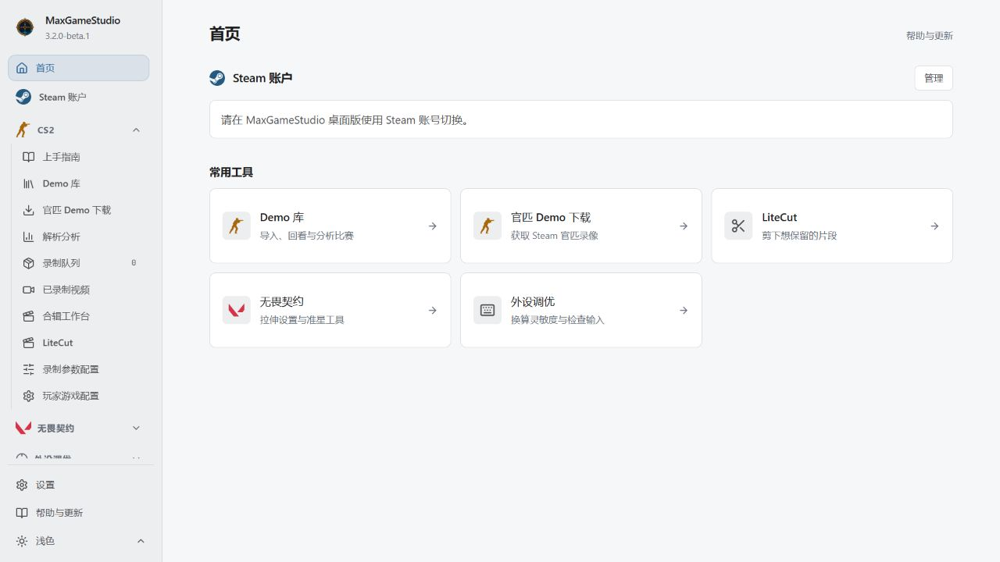

<h1 align="center">MaxGameStudio</h1>

<a href="./README.md">English</a> · 简体中文

Windows 桌面工具。主程序提供 CS2 复盘与录制、Steam 换号、无畏契约和外设调优。测试版将英雄联盟工具箱拆为独立应用。

## 下载

Windows 10/11 · x64

| 软件 | 版本 | 安装包 | 下载体积 |
| --- | --- | --- | --- |
| **MaxGameStudio 主程序** | 3.2.0-beta.2 | [下载 EXE](https://github.com/INEEDBUG/MaxGameStudio/releases/download/v3.2.0-beta.2/MaxGameStudio_3.2.0-beta.2_x64-setup.exe) · [SHA-256](https://github.com/INEEDBUG/MaxGameStudio/releases/download/v3.2.0-beta.2/MaxGameStudio_3.2.0-beta.2_x64-setup.exe.sha256) | 40.3 MiB |
| **MaxGameStudio League 工具箱** | 1.0.0-beta.5 | [下载 EXE](https://github.com/INEEDBUG/MaxGameStudio/releases/download/league-v1.0.0-beta.5/MaxGameStudioLeague_1.0.0-beta.5_x64-setup.exe) · [SHA-256](https://github.com/INEEDBUG/MaxGameStudio/releases/download/league-v1.0.0-beta.5/MaxGameStudioLeague_1.0.0-beta.5_x64-setup.exe.sha256) | 102.1 MiB |
| **MaxGameStudio 正式版** | 3.1.4 修复版 | [下载 EXE](https://github.com/INEEDBUG/MaxGameStudio/releases/download/v3.1.4/MaxGameStudio_3.1.4_x64-repair-setup.exe) · [SHA-256](https://github.com/INEEDBUG/MaxGameStudio/releases/download/v3.1.4/SHA256SUMS) | 137.4 MiB |

历史实测程序占用为 MaxGameStudio 主程序 3.2.0-beta.2 107–108 MiB，MaxGameStudio League 工具箱 1.0.0-beta.2 335 MiB。

GitHub 上每款软件保留 1 个测试版和最多 3 个正式版，同时保留 Git 标签和源代码历史。

程序占用不含用户数据和主程序使用的 Windows 共享 WebView2 运行库。3.1.4 修复正式版仍内嵌英雄联盟工作台。两个测试版可分别安装，并各自检查本软件的测试版更新。

[主程序发布说明](https://github.com/INEEDBUG/MaxGameStudio/releases/tag/v3.2.0-beta.2) · [工具箱发布说明](https://github.com/INEEDBUG/MaxGameStudio/releases/tag/league-v1.0.0-beta.5) · [全部版本](https://github.com/INEEDBUG/MaxGameStudio/releases)

*MaxGameStudio 3.2 测试版简体中文界面预览。*

## 功能

| 软件 | 功能 |
| --- | --- |
| **MaxGameStudio** |  切换本机 Steam 已保存账号。需要重新登录或 Steam Guard 时，在 Steam 中完成。 |
| **MaxGameStudio** |  导入和解析 CS2 Demo、用 2D 雷达复盘，在 OBS 录制高光或用 LiteCut 剪辑。 |
| **MaxGameStudio** |  预览无畏契约拉伸设置、编辑准心，测试灵敏度和磁轴键盘参数。 |
| **MaxGameStudio League** |  连接本机英雄联盟客户端，使用选人配置、战绩、实时对局面板及 RESG 海克斯大乱斗资料窗口。 |

[上手指南](./PLAYER_GUIDE.md) · [详细功能与历史截图](./docs/feature-reference.zh-CN.md)

## 安装与数据

1. 正常双击所需软件的安装包。两款向导均为简体中文，可选择**仅为我安装**或**为所有用户安装**；后者继续时会申请管理员权限，将程序安装到 Program Files。
2. 主程序测试版可用同一 Windows 账户覆盖 3.1.4 修复正式版，保留原数据位置、配置和数据库。当前用户模式沿用原程序目录，主动迁移数据时保留源目录。
3. 英雄联盟工具箱单独安装。首次启动时可将检测到的旧内嵌工作台配置和数据库复制到独立数据目录，原数据会保留。

“仅为我安装”可自选程序和数据目录；“为所有用户安装”共享程序文件，各账户保留各自的数据位置。Windows 权限弹窗跟随系统显示语言。

换号前请先退出游戏，等待 Steam 云同步完成。Steam 可能要求重新登录。

## 开发与许可证

MaxGameStudio 是非商业衍生项目，由 **INEEDBUG** 维护。[项目归属](./AUTHORS.md) · [开发环境](./docs/dev-setup.zh-CN.md) · [参与贡献](./CONTRIBUTING.md)

项目采用 PolyForm Noncommercial 1.0.0。分发时请保留适用的版权和许可声明。[项目许可证](./LICENSE) · [第三方许可证](./THIRD_PARTY_LICENSES.md)

## 参考项目与致谢

- CS2 Insight Agent 是项目参考来源，CS Demo Manager 是官匹 Demo 工作流的参考。[DrEAmSs59/CS2-insight-agent](https://github.com/DrEAmSs59/CS2-insight-agent), [akiver/cs-demo-manager](https://github.com/akiver/cs-demo-manager)
- 可选的 Steam Game Coordinator 辅助程序经首次使用确认后下载，以未经修改的独立进程运行。[boiler-writter（GPL-3.0）](https://github.com/akiver/boiler-writter)
- Share Code 解码为 csgo-sharecode 的 Python 适配，独立英雄联盟工具箱基于 LeagueAkari 1.5.1。[csgo-sharecode（MIT）](https://github.com/akiver/csgo-sharecode) · [LeagueAkari（MIT）](https://github.com/LeagueAkari/LeagueAkari)
- 游戏名称和标识归各自权利人所有。本项目独立维护。[商标和图标归属](./THIRD_PARTY_LICENSES.md#trademark-notices)
