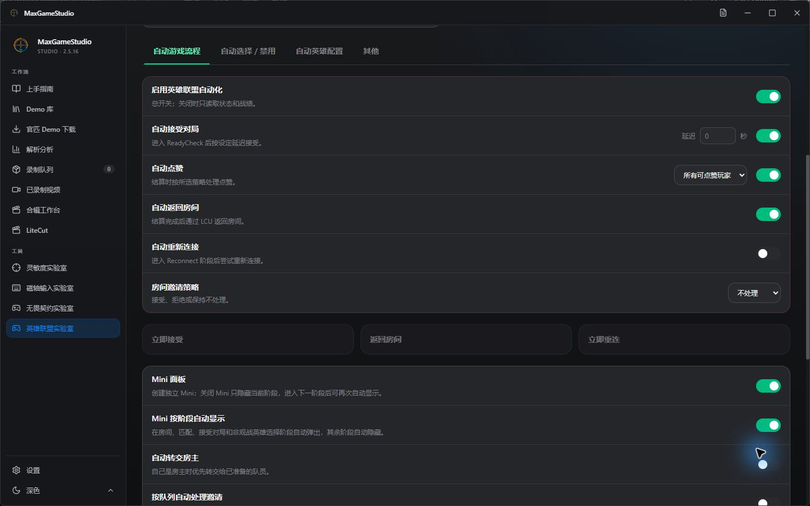
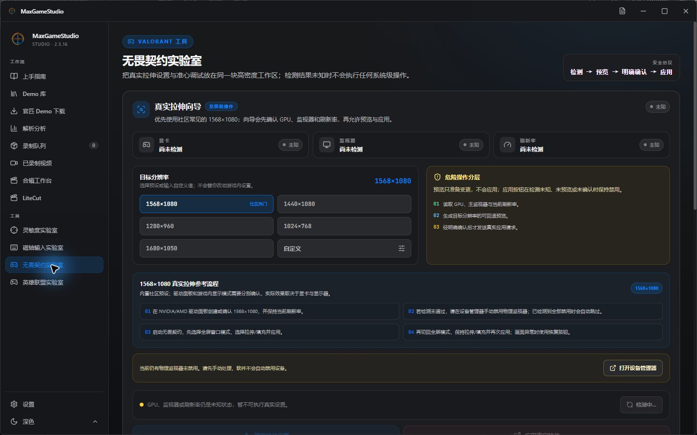

# MaxGameStudio feature reference

[Downloads and installation](../README.md) · [简体中文](./feature-reference.zh-CN.md)

This reference covers the main app and records the League workspace shipped with 3.1.4 stable. To use League with the beta, install MaxGameStudio League separately.

## Historical screenshots

Screenshots show the v2.5.16 desktop UI with local demo data.

<table>
  <tr>
    <td width="50%" align="center"><b>League Lab: game-flow automation and Mini panel</b> </td>
    <td width="50%" align="center"><b>VALORANT Lab: true-stretch guide and crosshair tools</b> </td>
  </tr>
</table>

## Demo Library Management

- **Local Library Records** — List and thumbnail view showing match source, scoreboard, tracked players, display names, notes, and other key info.
- **Recent-Match Performance Board** — The default library view now follows a left-side recent-match rail plus selected-match detail layout. Existing analysis caches directly populate round results, both team scoreboards, K/D/A, ADR, KAST, Rating Pro 2.0/3.0, and the match hero/culprit. Grid and list views remain available.
- **Verified Match Time and Provenance** — Official share-code downloads persist Steam Game Coordinator `matchtime` separately from import time. SQLite sorting covers the complete paginated library. Older rows without server time explicitly show “match time unknown”; import time is only secondary context and is never relabeled as the match date. Cached official share codes can backfill older records.
- **Auto Directory Monitoring** — Supports monitoring demo download directories from 5E, Perfect World, Official Matchmaking, FACEIT, etc., with one-click import.
- **Local Steam Recent Matches** — Requires no personal Steam Web API key, game authentication code, or browser cookie. The app connects to the currently signed-in local Steam Game Coordinator and shows the latest eight official matches with verified match time, map, score, K/D/A, headshots, and MVPs. A demo is downloaded only when requested. Damage, ADR, KAST, and Rating are shown as unavailable until the demo is parsed locally.

## Highlight Parsing & Clip Discovery

- **Batch Demo Parsing** — Parse highlights from multiple demos simultaneously; highlights from the same player across different matches are organized by match.
- **Persistent Analysis History** — Completed analysis is stored in the local SQLite database. Recent results can be reopened from the analysis page without reparsing the Demo.
- **History While Parsing** — The history panel remains visible while background analysis runs, together with an elapsed timer. History cards stay read-only until the active job finishes so a running session cannot be replaced accidentally.
- **Scoreboard First** — Base analysis now opens on the full-match scoreboard with K/D/A, ADR, KAST, headshot rate, openings, AWP and utility damage, plus an S–D grade and improvement notes for every player.
- **Rating Pro 2.0 / 3.0** — Estimates kills, survival, adjusted KAST, damage and impact with separate T/CT baselines. RP3 adds per-round economy, multi-kills, trades/flash assists and Round Swing, following HLTV's public October 2025 direction of raising kill weight and reducing Swing. The UI exposes all six subratings, confidence, pure saves and the economy modifier before identifying the winning side's hero and losing side's culprit. These are explicitly not official HLTV values; see the [methodology](./rating-pro-methodology.md).
- **Per-round Player Assessment** — The round explorer and completed 2D replay state grade every player from kills, deaths, openings, headshots and objective events.
- **Interactive 2D Replay** — Review round-by-round positions, paths, kills, smokes and fire areas. Click either side roster or a radar marker to select a player, with selection shared across the replay and assessment cards.
- **Single-team Tactical View** — Switch between global, Team A only and Team B only to filter opponent positions, paths, shots and utility. This is a review filter, not simulated geometric line-of-sight.
- **Target Player Lock** — Automatically identify all players in a match and locate targets by Steam ID, platform ID, or nickname; compatible with different demo export conventions from 5E, Perfect World, and Official Matchmaking.
- **Fine-grained Highlight Analysis** — Automatically categorizes **Highlights** (multi-kills, one-taps, clutches, knife kills, jump shots, defuses), **Fails** (taser, Deagle, team kills, "human magnet", "human tracing", "shoulder-to-shoulder" moments), **Cross-round Compilations** (favorite victim, nemesis, kill/death montage, continuous round recording), and **Meme Rounds** (211/o/i/z series with AI round commentary). See [Clip Types & Tags](./highlight_tags.md) for tag descriptions.
- **Round Timeline** — Beyond auto-extracted clip cards, browse kill/death timelines by round to add specific shots, deaths, or entire rounds to the recording queue.
- **Continuous Round Recording** — Record from round start to death or round end; select multiple rounds to combine into a longer clip.

> **First-run performance:** base Demo analysis and 2D replay cache generation are separate stages. The first visit to a match's 2D replay also creates the whole-match Parquet cache, round binary trajectories, and smoke/fire effect cache, so it can take longer than reopening the same match. Cache hits read the local result directly. Upgrades do not delete existing replay caches from the application data directory.

> **Steam credential safety:** recent-match discovery uses only the active local Steam client session. It does not read a Steam password, browser cookies, or a personal Web API key. The optional isolated Game Coordinator helper requires explicit first-use consent and is version- and SHA-512-pinned.

## Training & Input Labs

- **Personal Sensitivity Diagnosis** — Opens a touch-to-hit target arena plus continuous tracking rounds, showing each candidate from the configured `sensitivity`, `m_yaw`, and DPI. Completion automatically reveals the too-fast/too-slow diagnosis, exact adjustment percentage, CS2-ready command, and retest range.
- **Local CS2 CFG Prefill** — Read-only discovery of local Steam CS2 settings can prefill sensitivity, resolution, and aspect ratio. DPI and GPU scaling still require user confirmation.
- **Magnetic-key Optimization** — Uses duplicate edges, hold jitter, A/D overlap, and direction-transition latency to recommend starting values for actuation, RT press, and RT release, followed by controlled `0.05–0.10 mm` retests.
- **Official Matchmaking Input Safety** — Regular Rapid Trigger can shorten key reset, while Snap Tap, Rapid Tap, Snappy Tappy, SOCD/LKP, and similar automated counter-direction features should be disabled for CS2 official matchmaking.

## VALORANT

- **Safe true-stretch guide** — Reads the local GPU, primary monitor, and refresh rate, then prepares detection and preview results for the community-popular `1568×1080` preset, other presets, or a custom resolution. Applying a real display mode requires explicit confirmation and offers keep/restore during a countdown; monitor state is detected, but monitors are never disabled automatically.
- **Crosshair editor and sharing** — Edits primary, ADS, and sniper crosshairs using VALORANT's P/A/S profile structure, with live preview, strict encode/decode, native-format code import/export, and local preset history. A backend fallback is never presented as an equivalent native share code.
- **Visible risk boundaries** — System-level actions follow a detect → preview → confirm → apply flow. Missing hardware or display evidence leaves the page read-only instead of claiming success.

## League of Legends in 3.1.4 stable

- **One embedded workspace** — League features now enter through the MaxGameStudio-managed workspace; its pinned source and MIT attribution are recorded in the [third-party notices](../THIRD_PARTY_LICENSES.md).
- **Workspace startup modes** — Choose Ask every time, Save memory, or Run in parallel before launch. Save memory pauses host background tasks and destroys the main WebView; parallel keeps the main window, main WebView, backend, and background tasks running. Remembered choices are used only for automatic client detection; opening `/league` always lets you choose again, and the choice can be cleared later.
- **Workspace administrator option** — Optionally elevate only an isolated, revalidated League workspace copy; MaxGameStudio itself remains at standard privilege. The administrator choice can be remembered with the startup mode. Windows requests UAC according to its policy, and cancelling it leaves the main window and backend running.
- **Automated game flow** — Uses local LCU/SGP integration for Riot and WeGame/Tencent clients to cover ready-check acceptance, matchmaking, play again, reconnect, honor, room invitation policies, and the phase-aware Mini panel.
- **Champion select and loadouts** — Configures champion pick/ban priorities, runes, summoner spells, and builds by mode and position, while exposing bench, swap, skin, and trade state. Local profiles replace the former dependency on a separate OP.GG window.
- **Match history and live analysis** — Provides cross-region Riot ID lookup, paginated SGP history, encounters, local labels, SQLite collection, combined filters, player center, ten-player ongoing-game analysis, premade inference, jungle-route profiles, a dedicated live window, and an optional summoner-spell timer.
- **Account and privacy boundaries** — The account-write master switch is prominent, high-risk manual actions require confirmation, and current LCU state is checked immediately before execution. LCU, Riot Client, and SGP credentials remain in memory and are never exported or uploaded.

## Auto Recording

- **Batch Recording Queue** — Queue multiple matches and clips; the program sequentially launches CS2 replay and drives OBS to produce videos; preview the entire plan before recording, with per-clip timing adjustments in the queue.
- **Pre-recording Spectator Settings** — One-click spectator HUD configuration (death notices only, hide IDs/chat/demo bars), FOV and viewmodel, flash brightness, voice, resolution and aspect ratio, OBS transitions between clips; experimental POV first-person HUD can be enabled per-match.
- **Diverse Output Styles**:
  - Observer view or POV first-person HUD (toggle radar, adjust top player count display)
  - Clean spectator view, custom FOV, hide grenade trajectories
  - **Victim POV** — After highlight or multi-kill compilations, automatically append victim perspective clips
  - **Keyboard Overlay** — Display WASD, crouch/jump keys in OBS, with manual sync adjustment if needed
  - Fade in/out transitions between clips
- **Safe Recording Solution**:
  - Controls recording via OBS and game state coordination, no injection or game hooking
  - Automatically backs up and restores your keybinds and graphics settings after recording

## Compilation Workbench

- Successfully recorded clips are automatically stored in the library; use the Compilation Workbench to drag-and-drop reorder, add BGM/transition themes, and export MP4; filter by highlight/fail/compilation/timeline types, with intro/outro arrangement.
- **Player Info Card** — Enable bottom-left corner watermark when exporting: briefly displays player nickname, clip type (highlight/fail/compilation), round and scenario tags (e.g., multi-kill, one-tap) at the start of each clip; upload custom avatars for each player appearing in the timeline, or display first letter of nickname if no avatar. Perfect for polished highlight intros without manual PR editing.
- **FFmpeg Configuration Required**: Download Windows builds from [FFmpeg Official](https://ffmpeg.org/download.html) or [gyan.dev](https://www.gyan.dev/ffmpeg/builds/), extract and set the full path to `ffmpeg.exe` in the settings page. Export prioritizes GPU hardware encoding (NVENC/QSV/AMF), falling back to software encoding if unavailable.

## AI Commentary (Optional)

- **OpenAI-Compatible Multi-Provider** — Built-in support for DeepSeek, Tongyi Qwen, Zhipu GLM, MiniMax, OpenAI, OpenRouter; local models via Ollama, LM Studio.
- **Sarcastic Persona Prompt** — Hype for highlights, roast for fails, meme deaths as jokes; hard constraint under 100 characters, single-line JSON output, no off-topic chatter.
- **Round Meme Compilation Review** — 211/o/i/z meme rounds trigger "Round Comprehensive Review", independent from clip-level scoring.

## Recording safeguards

- **Default Recording Process** launches CS2 with `-insecure` for local demo playback only; no DLL injection or hooking; does not modify `.dem` files on disk, does not connect to, modify, or interfere with any official game servers, matchmaking services, or anti-cheat systems, nor does it provide any cheating, detection bypass, or fair-play disruption features. **Do not use in parallel with a CS2 client logged into matchmaking servers** to avoid triggering unnecessary anti-cheat warnings.
- If you **actively enable POV** in "Common Parameters → Experimental Features", the program temporarily writes `pov.vpk` to CS2's `game/csgo` directory and **incrementally modifies** `gameinfo.gi`'s `SearchPaths` to load POV HUD resources; automatically restored after recording or abnormal termination. This mode also **forces** `-insecure` when launching CS2. **Do not use to connect to VAC-secured servers**.
- Recording temporarily modifies several CS2 archive cvars and keybinds. This project automatically backs up your original `config.cfg` / `video.txt` / `user_convars_*.vcfg` to the program data directory's `.cs2_config_backup` when starting recording, and restores them afterward; if settings were overwritten due to abnormal exit, manually retrieve original files from that directory.
