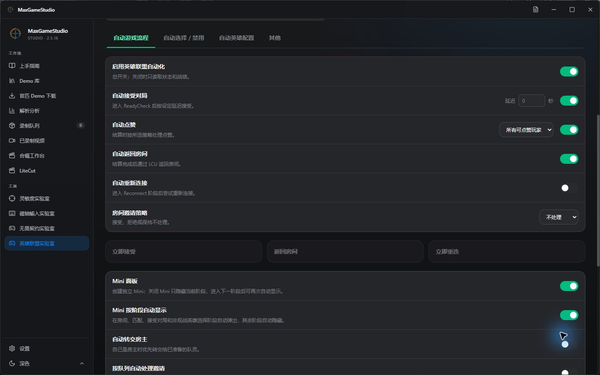
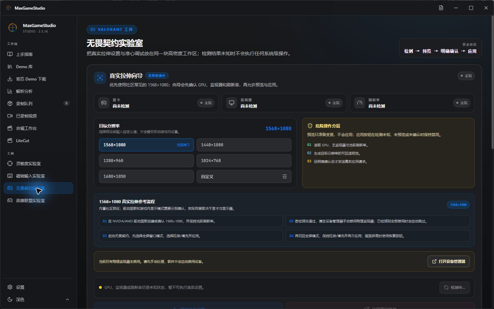

# MaxGameStudio 功能参考

[下载与安装](../README.zh-CN.md) · [English](./feature-reference.en.md)

本文介绍主程序功能，并保留 3.1.4 正式版内嵌英雄联盟工作台的说明。测试版的英雄联盟功能请使用独立安装的 MaxGameStudio League。

## 历史截图

截图来自 v2.5.16 桌面界面和本地演示数据，点击图片可查看原图。

<table>
  <tr>
    <td width="50%" align="center"><b>英雄联盟实验室：游戏流程自动化与 Mini 面板</b> </td>
    <td width="50%" align="center"><b>无畏契约实验室：真实拉伸向导与准心工具</b> </td>
  </tr>
  <tr>
    <td colspan="2" align="center"><b>近期战绩面板、真实比赛时间与双方记分板</b> </td>
  </tr>
  <tr>
    <td width="50%" align="center"><b>上手指南</b> </td>
    <td width="50%" align="center"><b>本地 Demo 库</b> </td>
  </tr>
  <tr>
    <td width="50%" align="center"><b>官匹 Demo 下载</b> </td>
    <td width="50%" align="center"><b>解析后默认计分板与全场评级</b> </td>
  </tr>
  <tr>
    <td width="50%" align="center"><b>可重新打开的历史分析</b> </td>
    <td width="50%" align="center"><b>单局玩家表现与优化方向</b> </td>
  </tr>
  <tr>
    <td colspan="2" align="center"><b>逐回合玩家评价与事件时间线</b> </td>
  </tr>
  <tr>
    <td width="50%" align="center"><b>OBS 录制队列</b> </td>
    <td width="50%" align="center"><b>合辑工作台</b> </td>
  </tr>
  <tr>
    <td width="50%" align="center"><b>LiteCut 剪辑器</b> </td>
    <td width="50%" align="center"><b>灵敏度实验室与本地 Steam CFG 预填</b> </td>
  </tr>
  <tr>
    <td width="50%" align="center"><b>磁轴输入实验室</b> </td>
    <td width="50%" align="center"><b>设置中心与昼夜模式</b> </td>
  </tr>
  <tr>
    <td colspan="2" align="center"><b>2D 雷达回放、玩家选中与单队视角</b> </td>
  </tr>
</table>

## Demo 库维护

- **本地库记录展示** — 列表、缩略图展示 Demo 的比赛来源、记分板、关注玩家、展示名、备注等关键信息。
- **近期战绩面板** — 默认采用“左侧近期比赛、右侧所选比赛详情”的战绩工具布局；直接复用已解析 Demo，展示回合胜负条、双方 K/D/A、ADR、KAST、Estimated HLTV Rating 2.0 / Rating Pro 3.0，以及双方各自的队内英雄和队内战犯。玩家头像来自 Steam 公共资料，点击名字可打开对应 Steam 主页；原网格与列表视图仍可随时切换。
- **真实比赛时间与来源标记** — 官匹分享码下载时读取 Steam Game Coordinator 返回的 `matchtime`，单独保存为真实比赛时间；排序在 SQLite 查询阶段覆盖全部分页。缺少服务器时间的旧 Demo 明确显示“比赛时间未知”，仅把入库时间作为辅助信息，不再冒充比赛日期；已缓存分享码的旧官匹可在战绩面板中补全。
- **目录自动监听** — 支持 5E / 完美 / 官匹 demo / faceit 等 Demo 下载目录的监听，一键自动入库。
- **本机 Steam 最近战绩** — 不再要求个人 Steam Web API Key、游戏认证码或浏览器 Cookie。软件直接连接当前已登录的本机 Steam Game Coordinator，自动显示最近 8 场官匹的真实比赛时间、地图、比分、K/D/A、爆头和 MVP；点击某场后才按需下载 Demo。Steam 最近战绩摘要不包含伤害、ADR、KAST 或 Rating，这些指标明确显示为 `—`，下载并解析 Demo 后才在本地计算，不会编造数值。
- **后台下载与全局进度** — 分享码和直接回放地址都交给桌面后端持续下载；切换功能页面、最小化窗口或驻留托盘不会中断。任意页面都会显示当前文件、阶段、百分比、实时下载速度和累计流量，Windows 任务栏同步显示进度；官匹下载页还能查看完整来源 URL、保存路径并直接打开文件位置。Demo 使用 HTTP GET 下载，因此任务上传量通常为 `0 B`；这里展示的是该 Demo 任务自身流量，不冒充整机网卡统计。彻底退出软件会停止尚未完成的任务。

## 高光解析与片段挖掘

- **批量 Demo 解析** — 支持同时解析大量 Demo 的高光时刻，同一玩家在多场 Demo 中的高光会按场次组织展示。
- **历史分析记录** — 已完成的分析会保存在本地 SQLite 数据库；分析页可直接打开最近记录并复用缓存，不会因为重启软件丢失，也不会为了查看历史重复慢解析。
- **解析时仍可浏览历史** — 后台解析期间保留历史分析面板，并显示整批任务持续运行时间；即使解析页因批次状态切换而重新载入，计时也不会回到 0。当前任务完成前历史卡片保持只读，避免切换记录覆盖正在处理的 Demo。
- **解析后先看计分板** — Demo 基础分析完成后默认打开全场计分板，集中显示比分、K/D/A、ADR、KAST、爆头率、首杀、AWP 与道具伤害，并给每位玩家生成 S–D 评级、优势和优化方向。
- **Estimated HLTV Rating 2.0 / Rating Pro 3.0** — Est. R2 采用公开社区逆向估算式，并用 csstats.gg 十人记分板样本做 ±0.01 回归校验，修复旧模型把高输出局过度压向 1.00 的问题；RP3 再加入逐回合经济、多杀、补枪/闪光助攻和 Round Swing。界面可展开六项分数、置信度、纯保枪和经济修正，并为双方分别标出队内英雄与队内战犯；评分明确不是 HLTV 官方值，算法边界见 [方法说明](./rating-pro-methodology.md)。
- **逐回合玩家评价** — 回合页和 2D 回放结束状态都会展示该回合全部玩家评价，综合击杀、死亡、首杀、爆头和下包/拆包事件。
- **交互式 2D 回放** — 可按回合查看双方站位、移动轨迹、击杀以及烟雾/燃烧范围；点击左右阵容 ID 或地图标记即可选中玩家，选中反馈会在阵容、地图和回合评价之间同步。
- **单队战术视角** — 可切换全局、仅 A 队或仅 B 队，过滤另一队的位置、轨迹、弹道和投掷物。该功能用于战术复盘，不声称模拟游戏内真实视线遮挡。
- **目标玩家锁定** — 自动识别对局内全部玩家，按 Steam ID、平台 ID 或昵称定位目标，兼容 5E、完美世界、官匹等不同 Demo 导出习惯。
- **细粒度高光分析** — 自动分出 **高光**（多杀、颗秒、残局、刀杀、跳杀、拆包等）、**下饭**（电击枪、沙鹰、队友误伤及「人肉吸铁石」「人体描边」「肩并肩」等名场面）、**跨回合合集**（亲儿子喂饭、本命苦主、全场击杀/死亡串烧、按回合连续录制），以及 **梗局**（211 / o / i / z 系列研发标签，可配 AI 整局总评）。标签说明见 [片段类型与标签](./highlight_tags.md)。
- **回合时间线** — 除自动挖出的片段卡片外，可按回合浏览击杀/死亡时间线，把某一枪、某一死或整回合画面直接加入录制队列。
- **回合连续录制** — 支持从回合开局录到死亡或回合结束，可勾选若干回合拼成一条长片。

> **关于首次解析耗时：** “Demo 基础分析”和“2D 回放缓存生成”是两个阶段。首次进入某场 Demo 的 2D 回放时，程序还需要生成整场 Parquet、当前回合二进制轨迹及烟雾/燃烧效果缓存，因此第一次会比再次打开更慢；缓存命中后会直接读取本地结果。升级版本不会删除应用数据目录中已有的回放缓存。

> **Steam 凭据安全：** 最近战绩功能只使用 Steam 客户端当前登录会话，不读取 Steam 密码、浏览器 Cookie 或个人 Web API Key。首次使用可选的独立 Game Coordinator 组件前会明确征求同意；组件版本与 SHA-512 固定，并与主程序隔离运行。

> **Steam 登录与 csstats.gg 边界：** Steam OpenID 只验证身份并返回 SteamID，本身不提供 CS2 逐局战绩；csstats.gg 的持续云端跟踪还要求用户另行添加游戏认证码与已知比赛。其条款禁止自动脚本与数据抓取，因此本项目不会爬取或嵌入其登录会话，而是使用本机 Steam GC 提供免 Key 的最近 8 场，并用本地 Demo 完成深度分析。

## 训练与输入实验室

- **个性化灵敏度诊断** — 进入碰到即命中的小球甩枪靶场与连续追踪测试，按当前 `sensitivity`、`m_yaw` 和 DPI 展示每轮候选参数；完成后自动定位到偏快/偏慢诊断、调整百分比、CS2 可直接使用的命令和建议复测区间。
- **本机 CS2 CFG 预填** — 以只读方式扫描本地 Steam 账号的 CS2 配置，预填当前灵敏度、`m_yaw`、分辨率和画面比例；DPI 与显卡拉伸模式仍由用户确认。
- **磁轴参数优化** — 根据异常重复边沿、保持抖动、A/D 重叠和方向切换延迟，分别给出触发行程、RT 按下及 RT 抬起的建议起点，并要求每次仅调整 `0.05–0.10 mm` 后复测。
- **官匹输入安全提醒** — 普通 Rapid Trigger 可用于缩短按键复位；在 CS2 官匹中应关闭 Snap Tap、Rapid Tap、Snappy Tappy、SOCD/LKP 等自动反向输入功能。

## VALORANT

- **真实拉伸安全向导** — 读取本机 GPU、主监视器和刷新率，为社区常用的 `1568×1080`、其他预设或自定义分辨率生成检测与预览结果。应用真实显示模式前必须明确确认，倒计时内可选择保留或恢复；软件会检测监视器状态，但不会擅自禁用监视器。
- **准心编辑与分享** — 按 VALORANT 的 P/A/S 配置结构编辑主准心、ADS 与狙击镜准心，提供实时预览、严格编解码、官方格式代码导入/导出和本机预设历史。后端不可用时只保存本机配置，不把降级结果冒充为原生分享码。
- **风险边界可见** — 页面按“检测 → 预览 → 明确确认 → 应用”分层展示系统级操作；硬件能力或显示状态证据不足时保持只读，不伪造成功。

## 英雄联盟工作台（3.1.4 正式版）

- **单一内嵌工作台** — 英雄联盟功能通过 MaxGameStudio 管理的内嵌工作台进入；源码版本及 MIT 归属见[第三方许可证](../THIRD_PARTY_LICENSES.md)。
- **工作台启动方式** — 进入工作台前可以选择“每次询问”“节省内存”或“后台并行”；节省内存会暂停主程序后台任务并销毁主 WebView，后台并行会保留主窗口、主 WebView、后端与后台任务。记住的选择只在检测到客户端时自动生效，手动进入 `/league` 始终可以重新选择，也可随时清除。
- **工作台管理员选项** — 可选只提升内嵌英雄联盟工作台，不提升整个 MaxGameStudio；管理员选择可随启动模式记住。Windows 按权限策略显示 UAC，取消授权会保留主窗口和后端。
- **自动游戏流程** — 与 CS2 功能共用同一个 Tauri 客户端和托盘，通过本机 LCU/SGP 兼容 Riot 与 WeGame/Tencent 客户端。覆盖自动接受、自动匹配、返回房间、掉线重连、自动点赞、房间邀请策略，以及按阶段自动显示的 Mini 面板。
- **选人、配置与对局操作** — 可按模式和位置配置英雄选择/禁用优先级、符文、召唤师技能与出装，处理备战席、换位、皮肤与交易等选人阶段状态；每项自动化仍由独立开关控制。符文、技能和出装均由本地配置管理，不依赖 OP.GG 独立窗口。
- **战绩与实时分析** — 提供 Riot ID 跨区检索、SGP 分页战绩、最近遇见、本地标签、SQLite 战绩收集、组合筛选、玩家中心、十人实时对局、组排推断与打野路线画像，并提供独立实时对局窗口和可选召唤师技能计时器。
- **账号与隐私边界** — 账号写入总开关在界面显著显示；手动高风险操作要求确认并在执行前重新核对 LCU 状态。LCU、Riot Client 与 SGP 令牌只保存在运行内存，不写入磁盘、不上传；设置导出不包含客户端凭据。

- **League 客户端高级工具** — 可输入任意 Game ID，自动在 LCU 与当前区服 SGP 间选择数据源，预览双方完整结算数据和时间线摘要，并把历史阵容只读载入实时对局面板；本地玩家标签按当前登录账号隔离，支持搜索、分页、编辑、删除及 JSON 导入导出，直播隐私模式下默认遮挡；玩家中心还会按英雄聚合胜率、KDA、伤害/补刀效率、团队资源占比和分路分布，实时对局可调并发与组排阈值并显示连胜、近况、补刀、视野、单杀等标签；另可选配桌面全局终止快捷键，默认关闭，触发时仍强制验证前台进程必须是 `League of Legends.exe`。

## 自动录制

- **已录制视频库** — 在软件内浏览并播放 OBS 成片、查看文件路径并在资源管理器中定位；可读取和修改当前 OBS Profile 的录制目录，新路径只影响后续录制，不会擅自移动旧视频。
- **批量录制队列** — 多场比赛、多个片段排队，程序依次启动 CS2 回放并驱动 OBS 成片；录制前可预览整批计划，队列里也可微调每段的节奏。
- **录制前观战设置** — 一键配置观战 HUD（仅死亡通知、隐藏 ID/聊天/Demo 条）、视野与持枪角度、闪光亮度、语音、分辨率与画幅、片段之间的 OBS 转场等；本场也可临时打开实验性 POV 第一人称 HUD。
- **多样化成片风格**：
  - 裁判视角或 POV 第一人称 HUD（可隐藏/显示雷达、调整正上方人数条）
  - 纯净观战画面、自定义 FOV、隐藏投掷物轨迹
  - **受害者视角** — 高光或多杀合集可在你的主视角之后，自动追加被击杀者视角片段
  - **按键显示叠加** — 在 OBS 里叠加 WASD、蹲跳等按键提示，与画面不同步时可手动微调
  - **击杀特效叠加** — 在颗秒、复仇、穿墙、盲狙、一石二鸟及多杀/残局发生时，由 OBS 自动叠加带透明通道和声音的特效视频
  - 片段之间淡入淡出等转场
- **安全录制方案**：
  - 通过 OBS 与游戏状态联动控制录制，不注入、不 Hook 游戏进程
  - 自动备份并在录制结束后恢复你的键位与画面设置

## 合辑工作台

- 录制成功的片段自动入库，可在合辑工作台拖拽排序、配 BGM / 转场主题，导出 MP4；支持按高光/下饭/合集/时间线等类型筛选，以及片头片尾编排。
- **玩家信息卡** — 导出时可开启左下角名牌：每段画面开头短暂显示该片段对应玩家昵称、高光/下饭/合集类型、回合与情景标签（如多杀、颗秒等）；可为时间线里出现的每位玩家单独上传头像，不上传则显示昵称首字。适合 B 站式集锦片头标注，无需后期在 PR 里逐条加字。
- **使用前需配置 FFmpeg**：前往 [FFmpeg 官网](https://ffmpeg.org/download.html) 或 [gyan.dev](https://www.gyan.dev/ffmpeg/builds/) 下载 Windows 构建包，解压后在程序设置页面的「FFmpeg 路径」中填入 `ffmpeg.exe` 的完整路径。导出时会优先使用显卡硬件编码（NVENC / QSV / AMF），没有则使用软件编码。

## AI 锐评（可选）

- **OpenAI 兼容多家厂商** — 内置 DeepSeek、通义 Qwen、智谱 GLM、MiniMax、OpenAI、OpenRouter；本地模型支持 Ollama、LM Studio。
- **毒舌人设 Prompt** — 高光吹爆、下饭嘲讽、梗死亡当段子；硬约束 100 字以内、单行 JSON 输出，不输出场外废话。
- **整局梗合集总评** — 211/o/i/z 系研发局会触发「整局综合评价」，独立于片段级评分。

## 录制安全提示

- **默认录制流程**调用 CS2 时使用 `-insecure` 仅用于本地 Demo 回放，不存在 DLL 注入或 Hook；不会对磁盘上的 `.dem` 做修改，不连接、不修改、不干预任何官方游戏服务器、匹配服务或反作弊系统，也不提供任何作弊、绕过检测或破坏公平竞技的功能，**不要在已登录匹配服务器的 CS2 客户端中并行使用**，以免触发反作弊系统的不必要警示。
- 若你在「常用参数管理 → 实验性功能」中**主动开启 POV**，程序会临时向 CS2 的 `game/csgo` 目录写入 `pov.vpk`，并**增量修改** `gameinfo.gi` 的 `SearchPaths` 以加载 POV HUD 资源；录制结束或异常收尾时会自动恢复。该模式同样**强制**使用 `-insecure` 启动 CS2，**不要用于连接 VAC 安全服务器**。
- 录制期间会临时修改若干 CS2 archive cvar 与按键绑定。本项目会在启动录制时在程序数据目录的 `.cs2_config_backup` 中**自动备份**玩家原始的 `config.cfg` / `video.txt` / `user_convars_*.vcfg`，录制结束后会回滚；如遇异常退出导致设置被覆盖，可在该目录手动取回原始文件。
